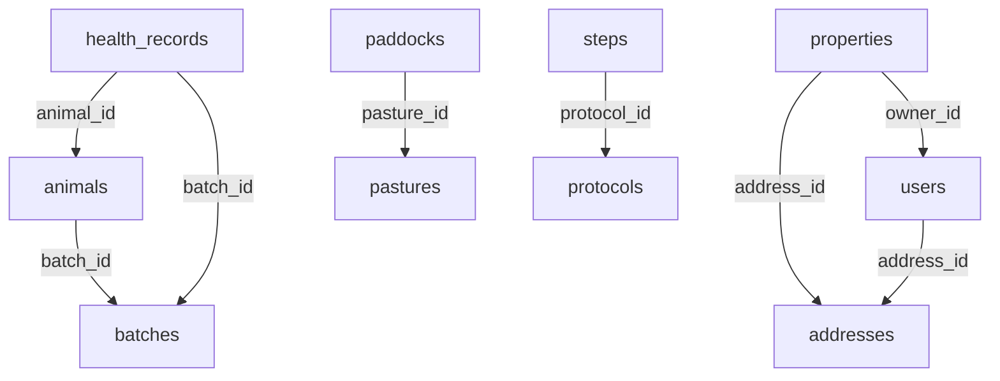

# Supabase Database Audit Report
**Project Reference:** `cwtgnymtmkpuavklwhmh`  
**Audit Date:** 2026-07-30  
**Database Size:** 13 MB  

---

## 1. Executive Summary

This report documents the security, schema, and performance audit of the remote Supabase PostgreSQL database. Overall, the database is in a **healthy** state for its current volume (13 MB), with high cache hit rates (Table: 99.87%, Index: 98.12%).

However, two major areas require immediate attention:
1. **RLS is enabled but has no policies:** All 22 tables have RLS enabled, but no policies have been created, meaning client-side access is completely blocked (fail-closed) for non-bypass roles.
2. **Missing Foreign Key Indexes:** Several foreign key columns lack matching indexes, which will result in sequential scans and slow cascade operations as the tables grow.

---

## 2. Row Level Security (RLS) Verification

An audit of `pg_tables` in the `public` schema confirms that RLS is correctly enabled on all tables.

| Table Name | RLS Enabled | Policies Found |
| :--- | :---: | :---: |
| `addresses` | **True** | 0 |
| `alembic_version` | **True** | 0 |
| `animal_events` | **True** | 0 |
| `animal_movements` | **True** | 0 |
| `animals` | **True** | 0 |
| `batch_movements` | **True** | 0 |
| `batches` | **True** | 0 |
| `death_records` | **True** | 0 |
| `email_verification_codes` | **True** | 0 |
| `health_records` | **True** | 0 |
| `owner_modules` | **True** | 0 |
| `owners` | **True** | 0 |
| `paddocks` | **True** | 0 |
| `password_reset_tokens` | **True** | 0 |
| `pastures` | **True** | 0 |
| `properties` | **True** | 0 |
| `protocols` | **True** | 0 |
| `reproductions` | **True** | 0 |
| `step_executions` | **True** | 0 |
| `steps` | **True** | 0 |
| `users` | **True** | 0 |
| `weighings` | **True** | 0 |

> [!WARNING]
> While having RLS enabled on all 22 tables is a great security baseline, **no active policies** have been defined in the `public` schema. By default, all operations (SELECT, INSERT, UPDATE, DELETE) attempted by standard roles (like `anon` and `authenticated`) via the Supabase Data API (PostgREST) will be denied. Ensure that either:
> - The backend always connects using a superuser/service role that bypasses RLS (as defined in [ADR-007](docs/04-architecture/adr/ADR-007-supabase-postgresql.md)).
> - Explicit, scoped RLS policies are created for any table that needs direct exposure to client applications.

---

## 3. Performance & Indexing Analysis

### Cache Hit Ratios
- **Table Cache Hit Rate:** **99.87%** (Excellent - data is read from memory rather than disk)
- **Index Cache Hit Rate:** **98.12%** (Excellent - indexes are efficiently cached)

### Missing Indexes on Foreign Keys
PostgreSQL does not automatically index foreign keys. Without an index, joins and cascade deletes require scanning the table sequentially. The audit identified the following missing indexes:



- **Table:** `animals`  
  - Missing Index on Column: `batch_id` (references `batches.id_batch` / `batches.property_id`)
- **Table:** `health_records`  
  - Missing Index on Column: `animal_id` (references `animals.id_animal` / `animals.property_id`)
  - Missing Index on Column: `batch_id` (references `batches.id_batch` / `batches.property_id`)
- **Table:** `paddocks`  
  - Missing Index on Column: `pasture_id` (references `pastures.id_pasture` / `pastures.property_id`)
- **Table:** `properties`  
  - Missing Index on Column: `address_id` (references `addresses.id_address`)
  - Missing Index on Column: `owner_id` (references `users.id_user`)
- **Table:** `steps`  
  - Missing Index on Column: `protocol_id` (references `protocols.id`)
- **Table:** `users`  
  - Missing Index on Column: `address_id` (references `addresses.id_address`)

> [!IMPORTANT]
> Missing indexes on foreign keys can degrade join performance and slow down deletions in parent tables if cascade rules are configured. It is strongly recommended to add indexes to these fields.

### Sequential Scans Analysis
Currently, sequential scans are high across several tables (e.g. `animal_events` with 358 seq scans, `step_executions` with 185, `batch_movements` with 181). 
Since the database size is small (13 MB), PostgreSQL's planner intentionally ignores indexes in favor of sequential scans. This is expected behavior at this stage, but these tables must be monitored as the dataset grows.

---

## 4. Recommendations & Remediation Plan

### Action 1: Create Missing Indexes
Apply the following migrations to create the missing indexes on foreign keys:
```sql
CREATE INDEX IF NOT EXISTS ix_animals_batch_id ON public.animals(batch_id);
CREATE INDEX IF NOT EXISTS ix_health_records_animal_id ON public.health_records(animal_id);
CREATE INDEX IF NOT EXISTS ix_health_records_batch_id ON public.health_records(batch_id);
CREATE INDEX IF NOT EXISTS ix_paddocks_pasture_id ON public.paddocks(pasture_id);
CREATE INDEX IF NOT EXISTS ix_properties_address_id ON public.properties(address_id);
CREATE INDEX IF NOT EXISTS ix_properties_owner_id ON public.properties(owner_id);
CREATE INDEX IF NOT EXISTS ix_steps_protocol_id ON public.steps(protocol_id);
CREATE INDEX IF NOT EXISTS ix_users_address_id ON public.users(address_id);
```

### Action 2: Audit API / Front-End Access
If the frontend or external clients ever query the database directly using Supabase libraries (client-side), you **must** define RLS policies. If all queries run through the backend API using `SessionLocal` / connection pool with privileged roles, the current setup is secure but means RLS is acting only as a secondary defense layer.
