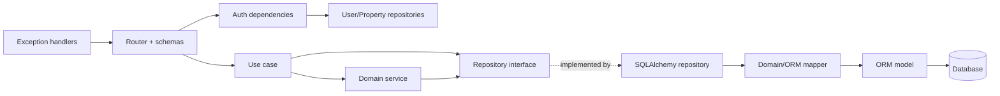

---
title: "Component Diagram"
type: explanation
status: partial
owner: engineering
canonical: true
ai_index: true
last_verified: 2026-07-16
---

# Diagrama de componentes do backend

O fluxo já aparece no módulo de animais. Lotes, áreas, pesagens e reprodução ainda usam serviços estáticos e devem migrar incrementalmente.
