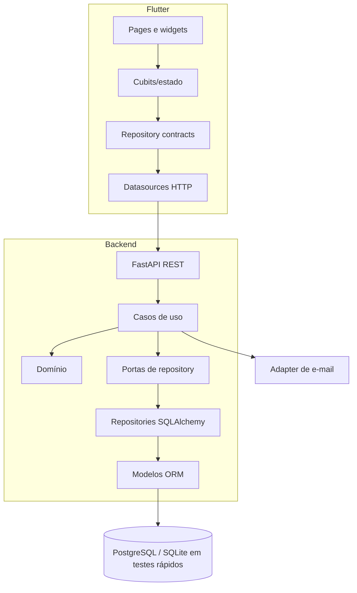

---
title: "Container Diagram"
type: explanation
status: partial
owner: engineering
canonical: true
ai_index: true
last_verified: 2026-08-14
---

# Diagrama de contêineres

Dependências apontam para o domínio. O estado atual ainda possui services legados que atravessam os limites mostrados.
