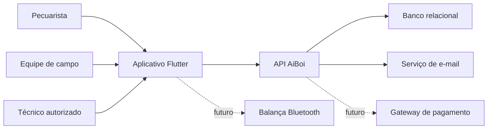

---
title: "Context Diagram"
type: explanation
status: partial
owner: engineering
canonical: true
ai_index: true
last_verified: 2026-07-16
---

# Diagrama de contexto

O aplicativo é o canal principal. API é a autoridade para autenticação, regras e tenant. E-mail atende verificação e recuperação. Pagamento e balança são futuros.
