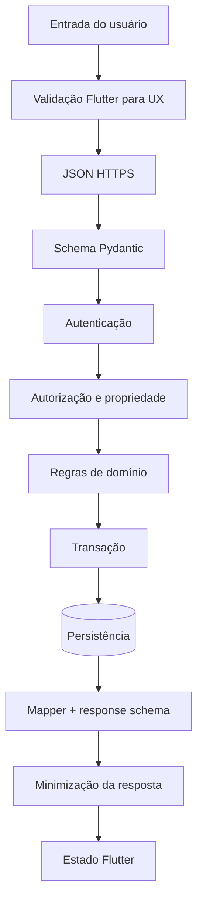

---
title: "Data Flow Diagram"
type: explanation
status: partial
owner: engineering
canonical: true
ai_index: true
last_verified: 2026-07-16
---

# Diagrama de fluxo de dados

A validação Flutter não é autoridade. Nenhum dado alcança a persistência antes de schema, identidade e tenant. Logs recebem correlation_id e metadados não sensíveis, nunca corpo completo com credenciais.
