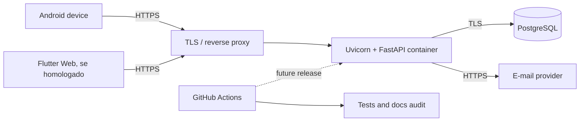

---
title: "Deployment Diagram"
type: explanation
status: partial
owner: engineering
canonical: true
ai_index: true
last_verified: 2026-08-14
---

# Diagrama de implantação

Produção requer HTTPS, segredo externo ao repositório, banco não público, backup e observabilidade. O pipeline de implantação ainda é planejado.
