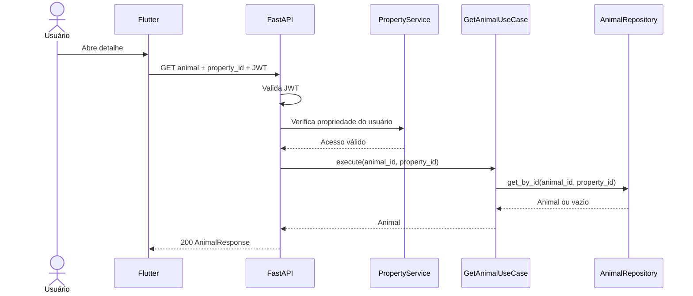
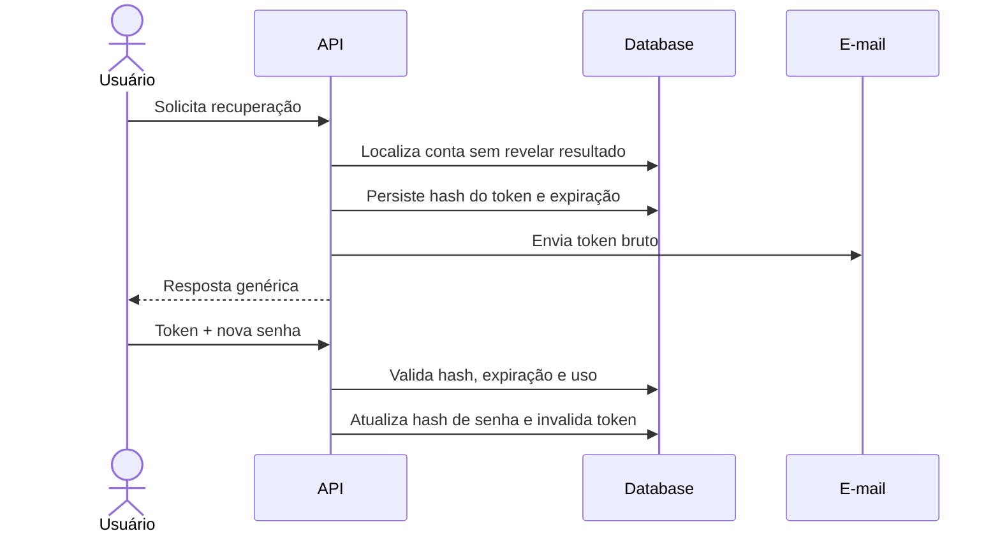

---
title: "Sequence Diagrams"
type: explanation
status: partial
owner: engineering
canonical: true
ai_index: true
last_verified: 2026-07-16
---

# Diagramas de sequência

## Consultar animal

## Recuperar senha

O segundo fluxo é o alvo seguro; o código atual ainda retorna o token bruto na primeira resposta.
